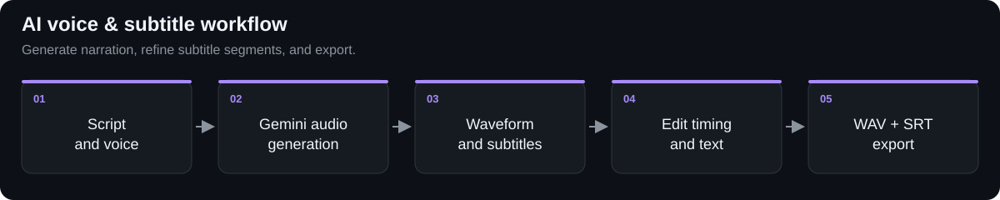

# AI Voice & Subtitle Editor

A browser-based narration tool that combines AI voice generation with waveform playback and subtitle editing.

## Workflow

## Capabilities

- Generates narration from a script with a selected voice through the Gemini API.
- Displays generated audio as an interactive waveform with playback controls.
- Supports subtitle timing adjustments, segment splitting, and segment merging.
- Shows a live SRT preview.
- Exports WAV audio and SRT subtitles.

## Engineering focus

React state coordinates the audio player, waveform regions, and editable subtitle segments. WaveSurfer.js provides waveform playback and region interactions, while TypeScript models the voice and subtitle data.

Subtitle timings are derived from detected speech segments and the script, then remain editable in the timeline.

**Stack:** TypeScript · React · Vite · Gemini API · WaveSurfer.js

*This page is a public project overview. Source code is maintained privately.*

[Back to my profile](https://github.com/akhilgghosh) · [Connect on LinkedIn](https://in.linkedin.com/in/akhilgghosh)
