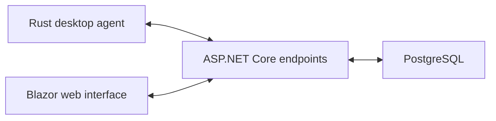

# Web Platform & Desktop Agent

A work-management application combining a web interface, a PostgreSQL data layer, and Rust desktop-agent components.

## System overview

## Components

- An ASP.NET Core server with agent, enrollment, account, and export endpoints.
- A Blazor interface with project, people, team, and reporting pages.
- A PostgreSQL data layer accessed through Entity Framework Core and Npgsql.
- A Rust workspace that separates shared agent logic from operating-system-specific components.

## Engineering focus

This project connects desktop and web development within one application. The server, data layer, and shared types are separate .NET projects; the desktop side uses a Rust workspace with dedicated platform components.

**Stack:** C# · ASP.NET Core · Blazor · Entity Framework Core · PostgreSQL · Rust

*This page is a public project overview. Source code and deployment details are maintained privately.*

[Back to my profile](https://github.com/akhilgghosh) · [Connect on LinkedIn](https://in.linkedin.com/in/akhilgghosh)
